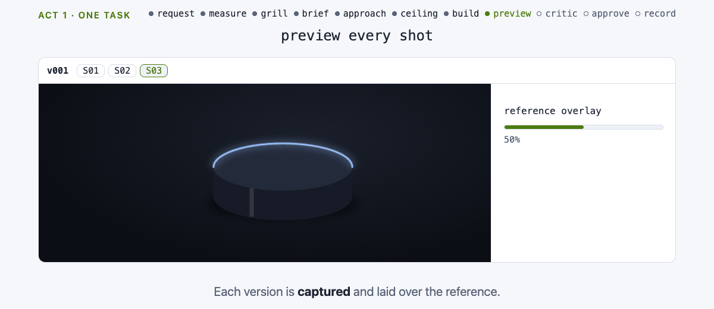

# 3d

**Turn a prompt, a photo or a video into a 3D reproduction, and ship it where it lives: an
interactive element on your page, a Blender asset, a render or a web-ready GLB.**

`3d` is an agent skill for production 3D on the web and in Blender. Point it at a reference ("rebuild
the speaker in this clip in 3D, visitors spin it on our product page") or describe what you want. It
measures the reference into the most detailed spec it can, grills only the gaps, turns the answers
into a brief and a shot list you approve, picks the pipeline for where the piece will live (a model
visitors spin, zoom or configure, a live hero, a render, a game asset), builds it, shows you numbered
versions in a local viewer, has a fresh critic judge the evidence before you see it, and records every
decision in `3D.md`. Scroll-driven 3D is one placement among these.

[](LICENSE)

**Visual guide:** [3d-skill.vercel.app](https://3d-skill.vercel.app)

<a href="https://3d-skill.vercel.app">
  <picture>
    <source media="(prefers-color-scheme: dark)" srcset="site/assets/how-3d-works-dark-poster.png">
    
  </picture>
</a>

```text
intent + references → spec → brief + shots → approach → build → preview → iterate → record
```

Invoke as `/3d` or `$3d` (Codex) with a request, a reference file or URL, or a GLB or `.blend` path.

## Boundary

`3d` owns **the 3D piece**: request or reference → measured spec → approved brief and shots →
pipeline → build → versioned previews → the record in `3D.md`. It does not own the page around it:
2D scroll and DOM motion (`scroll-animation`), layout scaling (`fluid-design`), image or video
generation (`generate-image`, `generate-video`) and CAD-to-print orchestration
(`manufacturing-workflow`) belong to adjacent skills. `3d` recommends those, never invokes them, and
works alone. Project rules (`CLAUDE.md`, a motion doc, decisions already in `3D.md`) win over every
default in the pack.

Do not use it for a one-line fix you can see in the code; use it when the result has to *look right*.

## The loop

Every build runs the same seven stages ([docs/loop.md](docs/loop.md) has the artifacts, schemas and
gates for each). Smaller requests enter a lane and skip what they do not need: a symptom goes
straight to [shared-debug](skills/3d/references/shared-debug.md), a single change skips intake.

1. **Prepare.** With no `3D.md`, [shared-preflight](skills/3d/references/shared-preflight.md) runs
   `capabilities`, reads your stack and rules, batches one install proposal and fills `3D.md`.
2. **Intake: measured, then grilled.**
   - [intake-references](skills/3d/references/intake-references.md): `ref-extract` measures every
     image or video (frames, palette, luma, cuts, motion), then vision passes fill
     `.3d/reference-spec.json` in the [refspec](skills/3d/references/refspec.md) (`refspec.v1`) schema.
     Every estimate carries a range, a confidence and an evidence tag; what a reference cannot show is
     listed, not invented. [refspec-mapping](skills/3d/references/refspec-mapping.md) turns it into
     starting camera, light, tone and material values.
   - [intake-grill](skills/3d/references/intake-grill.md): looks up facts itself, then asks only the
     gaps, in rounds of at most six questions, each with a recommended answer that "yes" accepts. The
     turn ends on a restated brief and your explicit yes. No live user: it writes `.3d/questions.md`
     and stops.
3. **Brief, shots, sign-off.** [brief-spec](skills/3d/references/brief-spec.md) writes `.3d/brief.md`
   and `.3d/shots.json` (`shots.v1`); [brief-lexicon](skills/3d/references/brief-lexicon.md) turns
   "dramatic" and "glossy" into checkable words; the chosen look goes to `.3d/look.json`. Work then
   passes five gates in order, each on your yes: brief → style frames → blockout → lookdev → final.
4. **Approach by target use.** [brief-approach](skills/3d/references/brief-approach.md) maps a live
   object, hero, scroll world, scrub video, render, Spline, splat, AR, game asset, print or CAD to a
   pipeline and a four-rung fallback ladder, and names the area files to read next. A brief that
   matches a reference first passes the feasibility gate in
   [realism-gate](skills/3d/references/realism-gate.md): ceilings, ship bars and planned techniques.
5. **Build.** Only the files the pipeline names, one change-set per version
   (`preview new-version`).
6. **Preview and iterate.** [shared-preview](skills/3d/references/shared-preview.md) captures every
   shot and diffs it against the reference and the previous version;
   [shared-verification](skills/3d/references/shared-verification.md) hands the evidence to a fresh
   critic that is not told what was just fixed; then you get the URL, the version, what changed and a
   `preview board`. Your notes become the next version, until `preview rounds` says pass or stop.
7. **Record.** Claim-scoped verdicts, `glb-report` against the recorded budget, a version-log line
   in `3D.md`, `preview stop`, and a handoff receipt of at most 400 tokens.

## Areas

48 references in `skills/3d/references/`, read on demand, never preloaded
([docs/areas.md](docs/areas.md) says when each one routes).

| Area | References | Covers |
|---|---|---|
| Front door (7) | [intake-grill](skills/3d/references/intake-grill.md), [intake-references](skills/3d/references/intake-references.md), [refspec](skills/3d/references/refspec.md), [refspec-mapping](skills/3d/references/refspec-mapping.md), [brief-spec](skills/3d/references/brief-spec.md), [brief-lexicon](skills/3d/references/brief-lexicon.md), [brief-approach](skills/3d/references/brief-approach.md) | grilling, reference decomposition, brief, storyboard, shots, gates, pipeline choice |
| Engine and realism (4) | [engine-choice](skills/3d/references/engine-choice.md), [realism-gap](skills/3d/references/realism-gap.md), [realism-toolbox](skills/3d/references/realism-toolbox.md), [realism-gate](skills/3d/references/realism-gate.md) | three.js vs another engine; what real-time can match (live, bake-only, offline-only, artefact); ranked techniques; feasibility gate and deterministic stop rules |
| Shared (5) | [shared-preflight](skills/3d/references/shared-preflight.md), [shared-debug](skills/3d/references/shared-debug.md), [shared-performance](skills/3d/references/shared-performance.md), [shared-preview](skills/3d/references/shared-preview.md), [shared-verification](skills/3d/references/shared-verification.md) | tooling, symptom triage, budgets, versions and captures, evidence and critic |
| three.js and R3F (6) | [threejs-renderer](skills/3d/references/threejs-renderer.md), [threejs-r3f-next](skills/3d/references/threejs-r3f-next.md), [threejs-lookdev](skills/3d/references/threejs-lookdev.md), [threejs-loading](skills/3d/references/threejs-loading.md), [threejs-postfx](skills/3d/references/threejs-postfx.md), [threejs-interaction](skills/3d/references/threejs-interaction.md) | renderer, Next App Router, light and materials, loaders, post, picking and clips |
| Shaders (2) | [shader-glsl](skills/3d/references/shader-glsl.md), [shader-tsl](skills/3d/references/shader-tsl.md) | GLSL on `WebGLRenderer`; TSL and `WebGPURenderer` when needed |
| Design (2) | [design-art-direction](skills/3d/references/design-art-direction.md), [design-lookdev-presets](skills/3d/references/design-lookdev-presets.md) | world sentence, scene ledger, presets, one colour policy |
| Assets (2) | [asset-acquire](skills/3d/references/asset-acquire.md), [asset-pipeline](skills/3d/references/asset-pipeline.md) | stock and generative sourcing with licences; meshopt, KTX2, budgets |
| Blender (13) | [blender-channels](skills/3d/references/blender-channels.md), [blender-scripting](skills/3d/references/blender-scripting.md), [blender-modeling](skills/3d/references/blender-modeling.md), [blender-shading](skills/3d/references/blender-shading.md), [blender-uv-bake](skills/3d/references/blender-uv-bake.md), [blender-texturing](skills/3d/references/blender-texturing.md), [blender-geometry-nodes](skills/3d/references/blender-geometry-nodes.md), [blender-rigging](skills/3d/references/blender-rigging.md), [blender-animation](skills/3d/references/blender-animation.md), [blender-physics](skills/3d/references/blender-physics.md), [blender-lookdev-render](skills/3d/references/blender-lookdev-render.md), [blender-export](skills/3d/references/blender-export.md), [blender-version-traps](skills/3d/references/blender-version-traps.md) | headless and MCP, bpy scripting, modeling, materials, UVs and baking, textures, Geometry Nodes, rigging, animation, physics, look-dev and render, GLB export, 5.x traps |
| Scroll-driven 3D (3) | [scroll-conductor](skills/3d/references/scroll-conductor.md), [scroll-adapters](skills/3d/references/scroll-adapters.md), [scroll-video](skills/3d/references/scroll-video.md) | one conductor, native / Motion / GSAP / Lenis adapters, pre-rendered scrub |
| Optional (3) | [spline](skills/3d/references/spline.md), [splats-xr](skills/3d/references/splats-xr.md), [cad-print](skills/3d/references/cad-print.md) | Spline, Gaussian splats, WebXR and AR, CAD routing |
| Provenance (1) | [SOURCES](skills/3d/references/SOURCES.md) | where each technique came from, under which licence |

## Tools

`<skill>` is the installed skill directory. **Invoke every script by path, `<skill>/scripts/<x>`,
with your project root as the working directory**, so defaults such as `.3d` land in your project;
never run them from the skill directory. `preview` takes `--dir` (default `.3d`) for its work folder.

| Tool | Command | Gives |
|---|---|---|
| `capabilities` | `<skill>/scripts/capabilities [--root PROJECT] [--json]` | `.3d/capabilities.md`: tools with cost, stack, Blender and MCP hints, proposals. Never installs |
| `ref-extract` | `<skill>/scripts/ref-extract INPUT... [--out .3d/refs] [--frames 12] [--scene 0.3] [--regions N] [--motion-json] [--kymo]` | per reference `meta.json`, `frames/`, `contact.jpg`, `palette.json`, `luma.json`; video adds `cuts.json`, `motion.json`, and with the flags `regions.json`, `motion-summary.json`, kymograph images. Needs ffmpeg |
| `fit-camera` | `<skill>/scripts/fit-camera POINTS.json [--size W H] [--id S01] [--json]` | solves camera focal length and pose from at least 6 non-coplanar 2D-3D anchors (DLT) and emits a `shots.v1` shot |
| `spec-check` | `<skill>/scripts/spec-check FILE...` | validates `refspec.v1`, `shots.v1`, `look.v1`, `feasibility.v1`, `rounds.v1`; exit 1 names the bad fields |
| `glb-report` | `<skill>/scripts/glb-report FILE [--budget hero\|world\|ar\|none] [--target desktop\|mobile] [--json]` | triangles, draw calls, textures, extensions, size; PASS / WARN / FAIL, exit 1 on FAIL |
| `preview serve` | `<skill>/scripts/preview serve [--dir .3d] [--port 4173] [--allow-origin URL]` | loopback viewer for `.3d/` on its own port; reads `.3d/look.json` |
| `preview new-version` | `… new-version [--note "what changes"] [--technique T1,T8]` | `.3d/versions/vNNN/` with `manifest.json`; shown versions are never edited |
| `preview capture` | `… capture [--version vNNN] [--url URL] [--shots …] [--size WxH] [--end] [--clip SECONDS] [--pathtrace] [--headed] [--settle 120]` | `.3d/evidence/vNNN/<shot>.png` for every shot, through your installed Chrome; `--clip` also records an mp4 per shot, `--pathtrace` a path-traced `<shot>_pt.png` twin (WebGPU) |
| `preview diff` | `… diff A B [--edges]` | SSIM and PSNR as JSON; side-by-side, blend and difference images in `.3d/diffs/` |
| `preview match` | `… match [--version vNNN] --ref IMAGE\|DIR [--json]` | per shot vs a reference: SSIM, edge SSIM, mask IoU, luma grid, delta E, each PASS / WARN / FAIL |
| `preview sweep` | `… sweep --param name=a,b,c [--shot ID] [--ref IMAGE\|DIR]` | parameter variants of one shot (max 24) in `.3d/sweeps/vNNN/`, a contact sheet and `rank.json` |
| `preview compare` | `… compare A B [--stack v\|h] [--loops N]` | synced stacked mp4 of two clips or two versions |
| `preview rounds` | `… rounds [--json]` | reads `feasibility.json`, `rounds.jsonl` and manifests; prints the stop verdict (pass, stop S1-S4, continue) |
| `preview board` | `… board [--version vNNN]` | contact sheet `.3d/boards/vNNN.png` with shot ids and open notes |
| `preview feedback` | `… feedback [--version vNNN] [--json]` | your notes grouped by version and shot |
| `preview stop` | `… stop` | ends the server named in `.3d/preview.pid` |
| Blender scripts | `blender -b in.blend --factory-startup --python-exit-code 1 --python <skill>/assets/blender/<x>.py -- …` | `inspect_scene.py --json out` · `export_web.py --out x.glb [--apply auto\|none\|all]` · `render_shots.py --shots .3d/shots.json --out dir [--import GLB]` · `bake_maps.py --object O --maps … --out-dir D` · `material_from_maps.py --dir D` · `texture_prep.py --seam\|--tile\|--delight\|--derive IMG` · `uv_check.py --res N` · `rig_check.py` |
| TypeScript blocks | copy into your project and own them; read each header first | `assets/web/conductor.ts`, `adapters/{native,motion,gsap}.ts`, `r3f/SceneCanvas.tsx`, `bridge.ts` |
| Templates | copy into your project | `3D.md`, `brief.md`, `shots.json`, `refspec.example.json` in `assets/templates/` |

Every script is Python 3 standard library, exits 0 ok / 1 problems / 2 usage, and is executed by
[tests/](tests/). `preview capture` needs `pip install playwright` (no `playwright install`) and
Google Chrome; the viewer loads three.js from a pinned CDN, so preview needs network.
`<skill>/assets/web/bridge.ts` exposes a dev-only `?3d-preview` bridge in *your* app: the skill asks
before adding it and removes it on request.

**The dev server is yours.** The skill never starts, kills or restarts it; it asks for the URL.
`preview serve` serves `.3d/` only, on its own port.

## Preflight and installs

On first use `<skill>/scripts/capabilities` inventories the machine (node, Blender, gltf-transform,
gltfpack, ktx, ffmpeg, Playwright and Chrome, your 3D stack, Blender and Spline MCP hints) into
`.3d/capabilities.md`. Missing tools become **one batched proposal** with a cost label: free, free
account or PAID.

- **Nothing is installed without your explicit yes.** The skill proposes the exact command and why,
  and runs it only after approval.
- **`sudo` stays with you.** The KTX-Software `ktx` package (≥ 4.4, not `toktx`) is an official `.pkg`
  that needs `sudo installer`; the skill hands you the command to run yourself.
- **gltfpack comes from npm** (`npm i -g gltfpack`); Homebrew has no formula.
- **Paid generative 3D jobs** are approved per job and never resubmitted on timeout.
- **Blender MCP servers execute arbitrary Python**, so the skill asks for consent first.

Cost table and MCP setup: [docs/installation.md](docs/installation.md).

## Install

```bash
npx skills add gabros20/3d-skill -g -y
```

Or from a clone, for a specific host:

```bash
git clone https://github.com/gabros20/3d-skill.git
cd 3d-skill
./install.sh codex
```

| Target | Destination |
|---|---|
| `codex` | `${CODEX_HOME:-$HOME/.codex}/skills/3d` |
| `agents` | `~/.agents/skills/3d` |
| `claude` | `~/.claude/skills/3d` |
| `cursor` | `~/.cursor/skills/3d` |
| `antigravity` | `~/.gemini/config/skills/3d` and `~/.gemini/antigravity-cli/skills/3d` |
| `opencode` | `~/.config/opencode/skills/3d` |
| `grok` | `~/.grok/skills/3d` |
| `hermes` | `~/.hermes/skills/3d` |
| `all` | Claude, Codex and the cross-agent path |

The installer stages a complete copy before replacing an existing installation and restores the
previous one if replacement fails. Repository-only docs, evals, tests and site are not installed.

## Quick start

```text
/3d rebuild the speaker in this clip in 3D, visitors spin it on our product page [attach ref.mp4]
Use $3d to turn this product photo into a model people can rotate on the page.
Use $3d to make this look like the attached screenshot.
Use $3d to optimize hero.glb for the web and tell me whether it fits the budget.
/3d export product.blend as a web-ready GLB and render a turntable
/3d my R3F scene renders black
Use $3d to build a scroll-driven 3D section for /products from these references.
```

A new request gets a few rounds of questions (each with a recommended answer), then a restated brief
to approve. Nothing is built before that yes. Worked examples: [docs/usage.md](docs/usage.md).
Copyable prompts: [docs/recipes.md](docs/recipes.md).

## What it writes in your project

`3D.md` at the root (decisions, budgets, colour policy, scroll owner, tooling, scene ledger with a
licence per asset, version log) and `.3d/` (`capabilities.md`, `brief.md`, `refs/`,
`reference-spec.json`, `shots.json`, `look.json`, `versions/vNNN/`, `evidence/`, `diffs/`,
`boards/`, `feedback.jsonl`). Suggest gitignoring `.3d/versions` and `.3d/refs`. Layout and schemas:
[docs/loop.md](docs/loop.md#the-3d-layout).

## Repository map

```text
skills/3d/        the installed pack: SKILL.md router, references/, scripts/, assets/, agents/openai.yaml
docs/             installation, usage, loop, areas, recipes, research and design notes
evals/            activation, traversal, output and compression-ablation fixtures
tests/            executes every shipped script
scripts/          check-sync, lint-skill, count-skill-tokens (repo tooling)
site/ remotion/   visual guide and hero-video project
.codex-plugin/    package and release metadata
```

## Validate

```bash
./scripts/check-sync
```

Runs the structure lint (frontmatter, direct routing, the reference header contract, no `/Users/`
paths), compiles and tests every script, and type-checks `assets/web`.

## Documentation

- [Installation](docs/installation.md)
- [Usage](docs/usage.md)
- [The loop](docs/loop.md)
- [Areas](docs/areas.md)
- [Recipes](docs/recipes.md)
- [Evaluation fixtures](evals/README.md)

## Versioning

Semantic versions live in `.codex-plugin/plugin.json`, [CHANGELOG.md](CHANGELOG.md), git tags and
GitHub Releases, never in `SKILL.md`. **MAJOR** is an artifact-contract or invocation break (`3D.md`,
the `.3d/` layout, `refspec.v1`, `shots.v1`), **MINOR** is new areas or behavior-changing reference
material, **PATCH** is fixes and wording. Current: 0.1.0.

## Credits

Written in this repository's own words after surveying community three.js, Blender and brief-intake
skills; licences, commits and what was adapted versus inspired only are in [SOURCES.md](SOURCES.md).

## License

[MIT](LICENSE) · Tamás Gábor ([@gabros20](https://github.com/gabros20))
